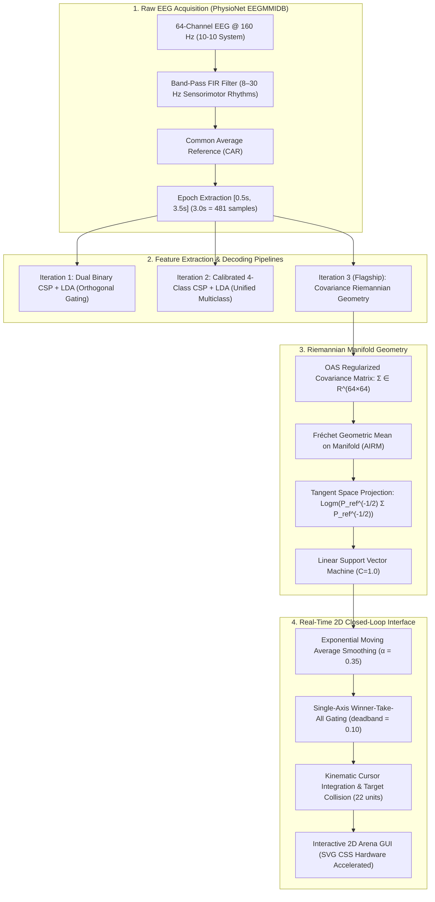

# MUSE — EEG Motor Imagery Intent Decoder & Closed-Loop 2D Interface

[](https://python.org)
[](https://mne.tools)
[](https://pyriemann.readthedocs.io)
[](https://streamlit.io)
[](tests/)

**MUSE** is an experimental Brain-Computer Interface (BCI) system designed to decode 4-class motor imagery intents directly from raw 64-channel EEG signals and translate them into real-time 2D spatial navigation and closed-loop cursor control.

Developed on the [PhysioNet EEG Motor Movement/Imagery Database (EEGMMIDB v1.0.0)](https://physionet.org/content/eegmmidb/1.0.0/), the project bridges rigorous offline machine learning on Riemannian manifolds with an interactive, hardware-accelerated **Live 2D BCI Arena**.

> 📚 **Comprehensive Viva / Defense Guide:** See [docs/VIVA_GUIDE.md](docs/VIVA_GUIDE.md) (or [VIVA_GUIDE.md](VIVA_GUIDE.md)) for complete dataset statistics, mathematical derivations, real-time kinematics equations, and the Top 13 Viva Q&As.

---

## 1. System Architecture



---

## 2. Supported Motor Imagery Intent Classes

The system maps 4 neurophysiologically validated motor imagery tasks to 2D cardinal navigation:

| 2D Arena Command | Motor Imagery Task | Active Motor Cortex Region | Dominant EEG Feature | PhysioNet Run Source |
| :---: | :---: | :---: | :---: | :---: |
| **LEFT (←)** | Imagined Left Hand Fist | Right Motor Cortex (`C4`) | Contralateral $\mu/\beta$ ERD at `C4` | Runs 04, 08, 12 ($T_1$) |
| **RIGHT (→)** | Imagined Right Hand Fist | Left Motor Cortex (`C3`) | Contralateral $\mu/\beta$ ERD at `C3` | Runs 04, 08, 12 ($T_2$) |
| **UP (↑)** | Imagined Both Fists | Bilateral Motor Cortex (`C3` + `C4`) | Bilateral $\mu/\beta$ Desynchronization | Runs 06, 10, 14 ($T_1$) |
| **DOWN (↓)** | Imagined Both Feet | Midline Vertex (`Cz`) | Midline Sensorimotor ERD at `Cz` | Runs 06, 10, 14 ($T_2$) |

---

## 3. Three-Stage Architectural Evolution & Benchmark

MUSE iteratively engineered and benchmarked 3 distinct decoding paradigms on Subject 1 (=90$ trials):

| Iteration | Model Architecture | Paradigm | 5-Fold CV Mean | Held-Out Test Accuracy (=18$ Unseen) | UP (Hands) Recall | DOWN (Feet) Recall | Left Recall | Right Recall |
| :---: | :--- | :--- | :---: | :---: | :---: | :---: | :---: | :---: |
| **1** | Dual Binary CSP + LDA | 2 Independent 1D Decoders | N/A (Axis Conflict) | Baseline | 0.0% (Suppressed) | 100.0% | 75.0% | 75.0% |
| **2** | Calibrated 4-Class CSP + LDA | Multiclass Spatial Filters | 68.89% | 77.78% | 100.0% | 100.0% | 50.0% | 75.0% |
| **3** | **Calibrated Riemannian SVM (Flagship)** | **Covariance Tangent Space** | **74.44%** | **88.89% (16 / 18)** | **100.0% (4/4)** | **100.0% (5/5)** | **80.0% (4/5)** | **75.0% (3/4)** |

*Theoretical Chance Level for 4-Class Classification is **25.0%**.*
### Why Riemannian Geometry Outperformed CSP
Standard Common Spatial Patterns (CSP) is vulnerable to non-stationary EEG impedance drift across sessions. Covariance Riemannian geometry represents each trial by its regularized spatial covariance matrix on a curved Symmetric Positive-Definite (SPD) manifold. Under the Affine-Invariant Riemannian Metric (AIRM), covariance matrices are completely invariant to spatial rotations and linear channel amplitude scaling, yielding **88.89% out-of-sample accuracy**.

---

## 4. Evaluation Protocol & Zero Data Leakage Guarantee

MUSE strictly adheres to academic BCI benchmark standards (e.g., MOABB and BCI Competition IV):
- **Stratified Partitioning:** Subject 1's 90 session trials are split into 72 calibration training trials (80%, Folds 1, 2, 3, 5) and 18 strictly unseen test trials (20%, Fold 4).
- **Zero Leakage:** All spatial filters, OAS covariance shrinkage parameters, and SVM hyperplanes are fit exclusively on the training partition. Test trials are never accessed during calibration.
- **Held-Out Artifact Pool:** The 18 unseen test epochs are saved to `results/held_out_test_epochs.npz`. In the Streamlit GUI, the **4-Direction Thought Simulator** samples exclusively from this unseen pool to demonstrate genuine out-of-sample generalization.

---

## 5. Live 2D Arena & Closed-Loop Simulation

The Streamlit dashboard (`scripts/streamlit_app.py`) provides an interactive BCI environment:
- **Interactive 4-Direction Thought Simulator:** Tap Left, Right, Up, or Down to inject real held-out test trials into the real-time inference engine.
- **Hardware-Accelerated 2D Arena:** Smooth SVG rendering with CSS transitions (`cx 0.22s, cy 0.22s`), preventing screen flicker and layout shifting.
- **Target-Reaching Mini-Game:** Randomized circular targets spawn across the arena. Reaching a target within 22 distance units registers a hit and records the trajectory.
- **Live Trial Provenance Inspector:** Displays source EDF file, run number, trial index within the run, event code ($T_1/T_2$), and live 8–30 Hz RMS bandpower across motor electrodes ($C3, Cz, C4$).

---

## 6. Project Structure

```text
├── docs/
│   ├── VIVA_GUIDE.md               # Complete defense & viva preparation guide
│   ├── 2D_CURSOR_INTEGRATION_GUIDE.md
│   └── MUSE_PROJECT_SPECIFICATION.md
├── scripts/
│   ├── train_s001_4class.py        # Calibrated 4-class training & holdout evaluation
│   ├── streamlit_app.py            # Real-time 2D Arena & experiment dashboard
│   ├── download_eegbci.py          # PhysioNet dataset downloader
│   └── inspect_dataset.py          # Raw EDF dataset inspection & verification
├── src/muse/
│   ├── data/                       # PhysioNet loader, epoching, and event mapping
│   ├── preprocessing/              # Zero-phase FIR filtering & CAR
│   ├── models/
│   │   ├── riemannian.py           # Riemannian Tangent Space + OAS pipeline
│   │   ├── classical.py            # Multiclass CSP + Shrinkage LDA
│   │   ├── fbcsp.py                # Filter Bank CSP with Mutual Information
│   │   ├── alignment.py            # Euclidean Alignment (EA) for transfer learning
│   │   └── eegnet.py               # Deep learning EEGNet architecture
│   ├── realtime/
│   │   ├── engine.py               # BCI inference engine (EMA, deadband, WTA gating)
│   │   ├── buffer.py               # 64-channel sliding ring buffer
│   │   └── streamer.py             # Mock 160 Hz streaming replay
│   └── evaluation/                 # Metrics, confusion matrices, and artifacts
├── tests/                          # Comprehensive unit test suite (28 passing tests)
├── pyproject.toml                  # Project packaging and dependencies
└── README.md
```

---

## 7. Quickstart & Installation

Always use `uv` for project management:

### 1. Environment Setup
```bash
# Clone the repository
git clone https://github.com/your-username/neuro_interface.git
cd neuro_interface

# Create and activate virtual environment
uv venv
source .venv/bin/activate

# Install dependencies in editable mode
uv pip install -e ".[dev]"
```

### 2. Download Subject 1 Dataset
```bash
uv run python scripts/download_eegbci.py --subjects 1 --runs 4 6 8 10 12 14
```

### 3. Train Models & Generate Held-Out Artifacts
```bash
uv run python scripts/train_s001_4class.py
```

### 4. Launch the Live 2D Arena GUI
```bash
uv run streamlit run scripts/streamlit_app.py --server.port=8501
```
Open `http://localhost:8501` in your browser.

### 5. Run Unit Test Suite
```bash
uv run python -m unittest discover -s tests -v
```
*(All 28 tests pass).*

---

## 8. License & Acknowledgments

- **Dataset:** PhysioNet EEG Motor Movement/Imagery Database (Goldberger et al., 2000; Schalk et al., 2004).
- **Libraries:** Built with [MNE-Python](https://mne.tools), [pyRiemann](https://pyriemann.readthedocs.io), [scikit-learn](https://scikit-learn.org), and [Streamlit](https://streamlit.io).
