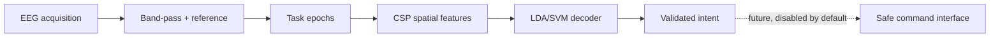

# MUSE — EEG Motor-Imagery Intent Decoder

MUSE is an experimental EEG brain-computer interface project. Its first
scientifically bounded goal is decoding a defined motor-imagery task, not
reading arbitrary thoughts or producing unrestricted brain-to-text.

## Vision and scope



The immediate target is a reproducible offline LEFT-versus-RIGHT classifier
using imagined unilateral fist movement. Later work may investigate additional
experimental classes, subject/session generalization, and live streaming.
Operating-system commands are not issued from predictions, and real-time EEG
streaming is not implemented yet.

## Current implementation status

| Milestone | Status | Evidence |
|---|---|---|
| Repository and environment audit | done | Initial scaffold and `.venv` inspected |
| PhysioNet event-label verification | done | Official EEGMMIDB documentation reviewed |
| Download/setup workflow | done | `scripts/download_eegbci.py` |
| MNE filtering and event-based epoching | done | `src/muse/preprocessing/epochs.py` |
| Grouped CSP + LDA baseline | done | `src/muse/models/classical.py`, `scripts/run_experiment.py` |
| Unit tests | done | 10 synthetic/software tests pass in the current environment |
| Real EEG baseline result | measured | Subject 1, 22 retained epochs, recording-held-out accuracy 59.09% |
| Bilateral task experiment | planned | Uses real labels `BOTH_HANDS`/`BOTH_FEET` |
| Model comparison | initial result measured | CSP+LDA and CSP+linear-SVM tie on the subject-1 subset |
| Session/subject-held-out robustness | initial result measured | Five-subject held-out sensitivity run; broader evaluation pending |
| Real-time decoder | planned | No supported EEG stream is configured |

## Dataset and supported intent classes

MUSE uses the PhysioNet EEG Motor Movement/Imagery Database (EEGMMIDB),
version 1.0.0. It contains 64-channel EEG sampled at 160 Hz from 109
participants, with event annotations `T0`, `T1`, and `T2`.

The event code meaning depends on the run and is not globally interchangeable:

| MUSE target | Actual EEGMMIDB event/task | Evidence | Implemented | Validation status |
|---|---|---|---|---|
| LEFT | Imagined left fist; `T1` in runs 4, 8, 12 | [PhysioNet event documentation](https://physionet.org/content/eegmmidb/1.0.0/) | yes | Software and initial real-data result validated |
| RIGHT | Imagined right fist; `T2` in runs 4, 8, 12 | [PhysioNet event documentation](https://physionet.org/content/eegmmidb/1.0.0/) | yes | Software validated; real-data result pending |
| UP | No validated UP/tongue class in EEGMMIDB | PhysioNet documents bilateral hands/feet, not tongue | no | Unsupported by selected dataset |
| DOWN | No validated DOWN class; `T2` in runs 6, 10, 14 means both feet | [MNE EEGBCI run table](https://mne.tools/stable/generated/mne.datasets.eegbci.load_data.html) | no | Not relabeled from feet |
| BOTH_HANDS | Imagined both hands; `T1` in runs 6, 10, 14 | [PhysioNet task description](https://physionet.org/content/eegmmidb/1.0.0/) | loader supports it | Separate experiment pending |
| BOTH_FEET | Imagined both feet; `T2` in runs 6, 10, 14 | [PhysioNet task description](https://physionet.org/content/eegmmidb/1.0.0/) | loader supports it | Separate experiment pending |
| REST/NEUTRAL | `T0` rest annotations | PhysioNet documentation | no | Future no-command experiment |

Runs 3/7/11 and 5/9/13 contain executed movement and are deliberately not
used in the motor-imagery baseline. The dataset does not contain a tongue
imagery class. A four-direction decoder therefore cannot be claimed from this
dataset. A future four-command study would need a dataset with four
experimentally defined imagery tasks, or a new controlled data-collection
protocol; the labels must be evaluated rather than assigned by convenience.
One concrete public option is the [official BCI Competition IV page](https://www.bbci.de/competition/iv/),
which documents Dataset 2a with four cued motor-imagery classes: left hand,
right hand, feet, and tongue. MUSE would still need a separate ingestion
adapter, preprocessing audit, and held-out evaluation before assigning the
feet/tongue classes to product commands DOWN/UP.

## Repository structure

```text
configs/                  Reproducible experiment settings
data/README.md            Dataset setup and raw-data policy
notebooks/                Reserved for exploratory notebooks
results/                  Generated metrics, plots, and models (ignored)
scripts/
  download_eegbci.py      Download an explicit subject/run subset
  inspect_dataset.py      Inspect EDF metadata and annotations
  run_experiment.py       Grouped CSP+LDA or CSP+SVM experiment
  compare_models.py       Same-fold model comparison
src/muse/
  event_mapping.py        Pure PhysioNet run-label mapping
  data/                    Download and dataset assembly
  preprocessing/           Filtering, epoching, validation
  models/                  Classical CSP pipelines
  evaluation/              Metrics, confusion matrix, artifact saving
  realtime/                Reserved safe streaming interfaces
tests/                    Synthetic/software tests
PROJECT_STATUS.md         Current repository state
experiments/EXPERIMENT_LOG.md  Real experiment history
```

## Environment setup

The existing environment is Python 3.14.8 in `.venv`, with MNE 1.12.1,
NumPy 2.5.2, SciPy 1.18.0, scikit-learn 1.9.0, and Matplotlib 3.11.1. The
repository also contains `pyproject.toml` for an editable install:

```bash
python -m venv .venv
./.venv/bin/python -m pip install -r requirements.txt
./.venv/bin/python -m pip install --no-deps -e .
```

In the managed environment used during development, MNE and Matplotlib are
given writable temporary configuration directories automatically by
`src/muse/__init__.py`.

## Download and inspect data

Check free disk space before downloading. The initial reproducible subset is
one subject and the three imagined left/right runs, not the complete archive:

```bash
./.venv/bin/python scripts/download_eegbci.py --subjects 1 --runs 4 8 12
./.venv/bin/python scripts/inspect_dataset.py --subjects 1 --runs 4 8 12
```

The downloader uses MNE's PhysioNet EEGBCI helper and stores raw EDF files
under `data/physionet/`, which is excluded from Git. To download the separate
bilateral imagery runs, use `--runs 6 10 14`.

## Baseline experiment

Run software tests with one documented command:

```bash
PYTHONPATH=src .venv/bin/python -m unittest discover -s tests -v
```

Run the LEFT/RIGHT baseline after downloading the data:

```bash
PYTHONPATH=src .venv/bin/python scripts/run_experiment.py \
  --task unilateral --subjects 1 --runs 4 8 12 \
  --output results/unilateral_lda_grouped
```

The command uses Leave-One-Recording-Group-Out validation: each
subject/run recording is held out in turn, and CSP is fitted inside each
training fold. It writes `metrics.json`, `config.json`, `predictions.csv`,
`confusion_matrix.png`, and a final all-recordings `model.joblib` under the
chosen results directory. The final model is for reproducible offline
inference only; its evaluation score is the grouped held-out score, not the
training score.

The first measured results are below. The subject-1 baseline uses the default
150 µV peak-to-peak rejection. The five-subject generalization run disables
that rule because it removed every task epoch from some recordings; it is
reported as a preprocessing sensitivity result, not as a directly comparable
replacement for the baseline.

| Experiment | Classes | Validation | Epochs/groups | Accuracy | Balanced accuracy | Macro F1 |
|---|---|---|---:|---:|---:|---:|
| Subject 1 unilateral | LEFT/RIGHT | Leave-One-Recording-Group-Out | 22 / 3 | 59.09% | 59.17% | 59.01% |
| Subjects 1–5 unilateral | LEFT/RIGHT | Leave-One-Subject-Out, no rejection sensitivity | 225 / 5 | 46.67% | 46.79% | 42.13% |

To compare the two implemented classical candidates under the same folds:

```bash
PYTHONPATH=src .venv/bin/python scripts/compare_models.py \
  --subjects 1 --runs 4 8 12 \
  --output results/model_comparison.json
```

The subject-1 comparison produced identical results for CSP+LDA and
CSP+linear-SVM: 59.09% accuracy, 59.17% balanced accuracy, and 59.01% macro
F1 under the same three recording-held-out folds.

For an initial cross-subject check, download subjects 1–5 and hold out each
subject across all three runs. The `--no-reject` flag is explicit because the
default rejection threshold removes entire recordings in this small subset:

```bash
./.venv/bin/python scripts/download_eegbci.py --subjects 1 2 3 4 5 --runs 4 8 12
PYTHONPATH=src .venv/bin/python scripts/compare_models.py \
  --subjects 1 2 3 4 5 --runs 4 8 12 --grouping subject --no-reject \
  --output results/model_comparison_subject5_no_reject.json
```

That comparison scored CSP+LDA at 46.67% accuracy and CSP+SVM at 44.89% on
225 epochs. These five-subject results are below the 50% two-class reference
and should not be treated as evidence of a usable subject-independent decoder.

For the supported bilateral task, download runs 6/10/14 and run:

```bash
./.venv/bin/python scripts/download_eegbci.py --subjects 1 --runs 6 10 14
PYTHONPATH=src .venv/bin/python scripts/run_experiment.py \
  --task bilateral --subjects 1 --runs 6 10 14 \
  --output results/bilateral_lda_grouped
```

This experiment reports `BOTH_HANDS` versus `BOTH_FEET`; it is not a
four-direction UP/DOWN result.

## What the pipeline does

1. **Load:** MNE reads EDF recordings and their annotation channel.
2. **Filter:** an 8–30 Hz band-pass investigates the mu/alpha and beta
   motor-imagery range. The setting is configurable and is not claimed to be
   universally optimal.
3. **Reference and epoch:** an average EEG reference is applied, then task
   epochs start 1 second after the cue and end at 4 seconds. `T0` rest is
   excluded. MNE boundary and optional amplitude rejection are recorded. If
   rejection removes every task epoch from a recording, loading fails loudly;
   `--no-reject` is available only for an explicit sensitivity run.
4. **CSP:** Common Spatial Pattern learns spatial filters that emphasize
   class-specific variance. It is fitted inside each validation fold to avoid
   leakage.
5. **Classifier:** shrinkage LDA is the first baseline. A linear SVM using the
   same fold-fitted CSP representation is available as a comparison.
6. **Evaluation:** accuracy, balanced accuracy, macro F1, per-class precision,
   recall, F1, class counts, a chance-level reference, fold scores, predictions,
   and a confusion matrix are saved.

## Evaluation methodology and limitations

Epochs from one EDF recording are correlated, so a random epoch split can
inflate performance. The baseline groups by subject/run and holds out a whole
recording per fold. This is a within-subject, cross-recording test when one
subject is selected; it is not evidence of subject-independent generalization.
Use `--grouping subject` to hold out all requested runs from each subject.
The current one-subject run is a feasibility experiment, not a clinical or
real-world performance claim. The initial five-subject subject-held-out run
was below chance and broader evaluation is planned.

Amplitude rejection is a simple configurable safeguard, not a complete
artifact-removal system. Eye, muscle, line-noise, and movement artifacts need
additional investigation. The current pipeline does not implement ICA,
automated bad-channel repair, online adaptation, confidence smoothing, or
REST-based no-command behavior.

## Troubleshooting

- **Missing EDF files:** run `scripts/download_eegbci.py` with the same
  subjects/runs as the experiment.
- **No network access:** download the requested EDF files on a machine with
  access to PhysioNet, copy them below `data/physionet/`, then rerun the
  inspection/experiment command.
- **Read-only MNE or Matplotlib config:** MUSE uses temporary writable config
  directories when the home directory is read-only.
- **Unexpected labels:** check the run number. `T1`/`T2` mean fists in runs
  4/8/12 but hands/feet in runs 6/10/14.
- **Too few groups:** grouped evaluation needs at least two recordings and
  each training fold must contain every class.

## References

- [PhysioNet EEG Motor Movement/Imagery Database v1.0.0](https://physionet.org/content/eegmmidb/1.0.0/)
- [MNE EEGBCI dataset loader and run table](https://mne.tools/stable/generated/mne.datasets.eegbci.load_data.html)
- [MNE CSP motor-imagery example](https://mne.tools/stable/auto_examples/decoding/decoding_csp_eeg.html)
- Schalk et al., *BCI2000: A General-Purpose Brain-Computer Interface
  System*, IEEE TBME, 2004, DOI [10.1109/TBME.2004.827072](https://doi.org/10.1109/TBME.2004.827072).

